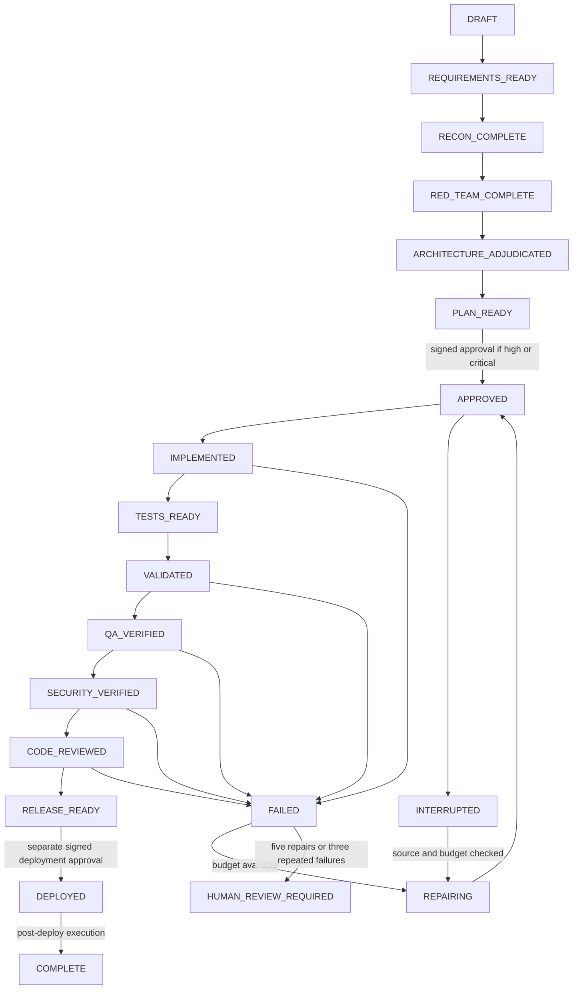

# Executable state machine

Source of truth: scripts/harness/state.ts. Contracts: scripts/harness/gates.ts.

Every stage is claimed before work and submitted after evidence validation. Intermediate running
ownership is a lease, not a pass. Planning failures need a new run. Any material source/scope/risk
change invalidates recon onward and approval; in-scope source changes invalidate implementation onward.
Recovery preserves accepted history and interrupts unfinished ownership. Uncertain deployments require
external human reconciliation and a new run; no automatic replay. Code-only runs end RELEASE_READY.
