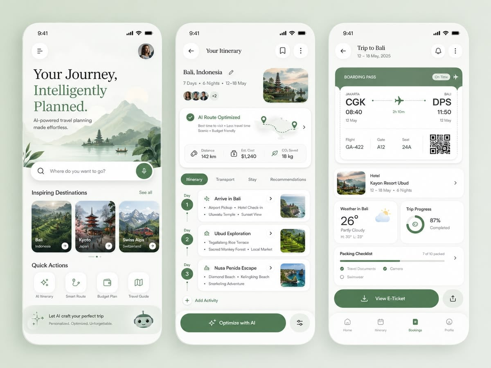

# ICS mobile: a calmer learning space

Mode: **Operate**. Platform: adaptive (Expo / React Native, iOS and Android).

THESIS: Make the next academic task easy to find, with welcoming typography and quiet surfaces rather than a wall of shortcuts.

OWN-WORLD: Existing ICS orange and navy ink, light/dark LMS surfaces, Manrope interface typography matching web, DM Serif Display only for the welcome. My Courses uses the user-confirmed fourth screenshot: a soft 22-point card, 58 × 64 image at left, title at right, metadata and links below. Course interiors use the recovered first-phase ICS checkpoint styles. Preserve instructor image customization. No green travel palette.

STORY: Identify current work, open a course, complete a task, and receive clear feedback. Professor views lead with real grading and enrollment queues.

FIRST VIEWPORT: Compact institutional header; welcome and actual summary; pending coursework or teaching queues; then courses. Shortcuts and calendar follow coursework. Preserve five role-specific navigation destinations.

FORM: Native task interface; approved soft editorial reference, not a website in a phone. Seed: `ics-mobile-ui-v2`. Generated comps are critique references, not new content or functionality.

FINISH: unreviewed and undocumented is unfinished; this build ends with the finish review, the verdict, DESIGN.md, and every shipping raster's provenance recorded.

## Reference and concept authority

The reference is the user's supplied three-screen travel concept, copied from the original clipboard attachment. Its creator/source was not supplied. It establishes spacing, approachable surfaces and hierarchy; it does not establish LMS content, colors, AI capabilities, travel imagery or navigation destinations.

Separate concepts: [student dashboard](assets/student-dashboard-concept.png), [professor dashboard](assets/professor-dashboard-concept.png), [dark course detail](assets/course-detail-concept.png), [dark tools sheet](assets/tools-sheet-concept.png). Exact built-in imagegen prompts are recorded in [concept-prompts.json](concept-prompts.json). Sample names, counts, dates, images and course data are illustrative. Actual app values come from existing APIs. The concepts predate the user's typography clarification; implementation uses the web app's Manrope/DM Serif Display families.

Historical concept provenance is retained. The latest card authority is the user's original fourth screenshot (attachment identifier ending `f891`), not the intervening old-Git card restoration. Interior authority is the exact earlier implementation handoff the user quoted: Manrope/DM Serif, 39 passing tests, CMake/Ninja build failure and flag off. Those test/build/flag details identify that historical checkpoint; they are not current verification outcomes. The rejected interior capture ending `9b3e` belongs to the preceding packet. Concepts do not override these confirmed targets.

## Isolation and compatibility

One auth-derived selector and authenticated-subtree context control the new native presentation styles. Only an enabled flag plus an authenticated ICS STUDENT or PROFESSOR/TEACHER in its matching subtree opts in. Hydration, missing credentials, unsupported roles, shared authentication and onboarding opt out. Background verification does not remove the existing offline authenticated experience. The original presentation-only baseline left auth-store behavior, schemas and API contracts unchanged. The initial functional follow-up added a narrow existing-field cover endpoint; the later independent-thumbnail amendment adds one nullable image field through the explicitly authorized additive migration. Auth behavior and protocol remain unchanged.

The context is identity/epoch keyed so account changes discard open sheets and presentation state. The mistaken course-route exclusion is removed: eligible course interiors again receive the same gated shared Card, Button and AppHeader presentation, including wrapping header behavior. Student/professor course index screens apply recovered `icsStyles` through `useIcsStyles`. Fonts remain scoped; no global defaultProps or native Text mutation is used. Auth, institute, role, hydration and build-flag eligibility are unchanged. The confirmed thumbnail course card itself uses its explicit layout in both presentations.

## Interaction and quality contract

- Press feedback 120 ms; routine transitions about 220 ms. Native stack transitions and dismissals keep existing routes and unsaved-work guards. Reduced motion removes spatial entrance/press effects.
- Orange is a fill/indicator. Small accent text uses tested dark orange in light mode and pale orange in dark mode. Status treatments must pass 4.5:1; selection has shape/weight and announced state.
- Welcome uses a 1.3 font-scale cap only for the serif treatment. Above 1.3 it becomes a smaller Manrope greeting with system scaling. Coursework and controls remain scalable.
- Tools are grouped without removing learning destinations. Sign out retains its existing v2 confirmation and logout behavior; the later request removes Switch Account from current UI.
- Existing NetInfo, scoped offline caches, uploads, recovery, idempotency and authenticated web bridges stay intact. Existing web theme injection stays intact.
- Native dashboards virtualize courses. Avoid per-row entrances and heavy shadows. Tablets remain supported; validate 768-point iPad and 800-dp Android tablet layouts.
- Compact v2 tab labels stay on one line: 11 units below 360-wide layouts, 12 otherwise, fit scale at least 0.85 and font-scale cap 1.2. This local navigation exception requires large-text acceptance; it does not change coursework scaling. The tools appearance switch has a minimum 48 × 48 target.

## Shipping policy

One complete reviewable change on `codex/ics-mobile-ui-overhaul`; no partial stage releases. `EXPO_PUBLIC_ICS_UI_V2` retains a false code/example/production default. The approved Expo/ngrok preview enables it, persisted only in ignored `.env.development.local`; this is a local preview override, not a production default change. No OTA pipeline, server flag, publishing or production seed execution is introduced. A disabled-flag rebuild is the fallback; this is not an instantaneous remote kill switch.

The early checkpoint requires both dashboards, tabs and tools in both themes on compact Android and iPhone. Native captures are evidence; web captures are supplementary. Missing native targets remain pending and block release acceptance, rather than being replaced by browser claims.

Physical performance target: Pixel 6a at 60 Hz, populated home and 100-item coursework fixture; fewer than 5% missed 16.7 ms frames, no interaction stall over 100 ms during the measured scroll, and median useful-content readiness no more than 10% worse over five equivalent warm runs. Hardware measurements must be recorded, never inferred from bundle compilation.

Defects and actual validation results live in `docs/quality/ics-mobile-ui-overhaul.md`. The implementing engineer owns fixtures and automation; Kirby owns physical-device checks and release acceptance. Unrelated blocking defects require a separately scoped repair.

## Later authorized scope — 4 November 2026

The follow-up to Kirby's four Android screenshots and subsequent cover-customization and Ohmward requests extends the original presentation-only scope. These functional repairs are also available with the existing ICS presentation; `EXPO_PUBLIC_ICS_UI_V2` still defaults to false and retains its original auth-derived visual scope.

- CodeLab gains CSS fullscreen on the existing mounted editor, visual-viewport keyboard sizing, and a native header/Back protocol. Exit fullscreen first; preserve normal history and unsaved-work confirmation afterward.
- At viewport heights up to 600 CSS pixels, non-fullscreen CodeLab scrolls vertically and keeps its panels at least 240 CSS pixels high without flex shrink, so results stay reachable below the toolbar in short landscape windows such as 667 × 375. Fullscreen layout is unchanged.
- Theme changes paint immediately with ordered preference writes. Remove the native snapshot/reveal overlay; synchronize embedded theme state and skip web snapshot transitions inside Expo.
- Knowledge Exchange adapts navigation, filters, cards, detail voting/actions, comments/options, anonymous settings, and editor footers to phone widths. Embedded sorting/buttons use 48 CSS-pixel minimums and selected filters expose state. Native-ready handling removes duplicate web chrome and floating widgets.
- Remove Switch Account UI; retain Sign out. Existing generated tools concepts are historical composition references and do not override this current behavior.
- Preserve the confirmed left-thumbnail course card and the recovered interior checkpoint styles. The initial cover editor changed the shared `Course.coverImage` through guarded `PATCH /api/courses/[courseId]`, with teaching/course access, owned-upload and image MIME checks. The later independent-mobile-image amendment below supersedes that shared-only behavior while preserving the accepted card geometry. The initial follow-up introduced no schema or auth protocol change.
- Keep cover errors in the sticky action footer beside Save/Cancel. Android's unregistered photo-launcher error explicitly asks the user to close and reopen the app; it is a known Expo launcher lifecycle limitation after density/activity recreation, not a completed lifecycle fix. Native uploads use intact Expo File multipart parts; web uses Blob parts. The shared SDK accepts an injected body factory and rechecks the token after preparing the file so an upload cannot continue across a changed sign-in.
- Integrate existing Ohmward lessons, progress, sandbox, and instructor analytics through authenticated student/professor in-app web workspaces. Add only the actual Ohmward routes to the session-bootstrap allowlist; preserve web access checks. Native-context embedded actions retain orange fills; layouts accommodate phone controls, inputs, and circuit-canvas scrolling.

No new concept generation or raster assets are added in this follow-up. Existing preset SVGs and user-supplied course imagery retain their sources. Original concept provenance above remains historical and unchanged.

Historical verification evidence lives in [mobile-workspace-followup.md](../../quality/mobile-workspace-followup.md). The Android APK built using local SDK CMake 3.31.6 / Ninja 1.12.1 and a process-only Gradle property, without a shipped native source/dependency build repair. Earlier `tmp/mobile-native-review` captures and fixture-backed journeys exercised dashboards/tools, CodeLab/Gboard/Back, Knowledge Exchange, Ohmward, Sign out and OS photo upload. These captures do not establish acceptance of the latest card/interior checkpoint restoration. The intervening `tmp/course-restored-review` old-Git restoration and its 46-test/route-exclusion claims are superseded, not current visual authority.

Current checkpoint restoration evidence is in `tmp/course-checkpoint-review` and [course-checkpoint-restoration.md](../../quality/course-checkpoint-restoration.md). Final mobile TypeScript, all 45 mobile tests, Expo Web export and the full synthetic student/professor journey passed after the press-feedback/professor-control correction. The independent checkpoint reviewer returned **ship** for source and all six supplementary preview captures, with the documentation fix resolved. At baseline acceptance, the public Android bundle was verified `checkpointEnabled: true` through inspected Expo 57 descriptor injection, with four matching baseline source files. On 5 November, Kirby confirmed in Expo Go: Cards and course interior are correct. This is the accepted course visual baseline; broader release checks remain separate. iPhone, live authenticated backend, physical performance, VoiceOver/TalkBack, large text, remaining tablet coverage, interruption/permission paths, activity recreation and circuit gestures remain pending. At that baseline checkpoint, no database changes or web deployment were performed. Detailed historical records remain in the quality report and [implementation reconciliation](../../quality/mobile-plan-reconciliation.md); the production flag default stays false.

The embedded layout, Ohmward bootstrap, and guarded cover-saving endpoint require deployment of the updated web portal/backend used by Expo. No deployment was performed; refreshing Expo alone does not publish those changes.

## Latest authoritative correction — confirmed course checkpoint

The user clarified that the intended card is the original fourth screenshot: left 58 × 64 image with 16-point corners, title/code on the right, metadata/links below, and soft 22-point outer corners. Current footer links/reorder controls use 48-point targets with wrapping. Keep safe private-image loading and the instructor-only Customize class cover editor. There is no top banner or overlaid white course title. `CourseCover` aspect ratio 3.2 is an editor preview only.

The card again uses checkpoint `SurfacePressable` feedback. Professor inline tabs now retain a 48-point minimum in v2, and the back control is 48 × 48 in v2; legacy dimensions remain when the presentation is disabled. The earlier inline override caveat is resolved. These are checkpoint corrections, not another visual redesign.

Interior style authority is the exact first-phase `icsStyles` object literals recovered from `tmp/ics-ui-final/_expo/static/js/web/entry-0240d0fe9a97e760a6bfbb4f5bcb54b6.js`. The extraction script is `tmp/restore-39-test-course-styles.cjs`; `tmp/course-checkpoint-restoration.json` records the source and style keys for both course index screens. These objects are applied through `useIcsStyles`, not approximated from a later capture. Student cards/groups use the recovered soft corners, control and title styles, centered content width and filter-scroll sizing; professor cards/modals/actions use their recovered counterparts. Shared course components again receive the normal eligible presentation because the erroneous route exclusion was removed. No new concept image generation is authorized.

## Authorized amendment — three course repairs, 5 November 2026

Kirby accepted the thumbnail cards and course interior in Expo Go. Preserve that baseline and its classwork layout; this amendment authorizes only the following repairs.

- Give the ICS student course page a local compact safe-area header: back control, code/section above the full title, then instructor. Observed type is 11 / 16 for code, 18 / 24 for title, and 12 / 18 for instructor. The title uses all remaining width beside Back, without competing right-side chips. Back is 48 × 48 when v2 is enabled; the shared helper retains its 44-unit disabled default. Other institutes retain their existing AppHeader fallback; no global AppHeader change is introduced.
- Remove the top Practical Labs button on student and professor course pages. Keep the feature in existing tools/routes and retain related classwork destinations.
- Add announcement Google Meet actions for both roles through `CourseMeetingLinks`. Match the web helper's valid HTTPS exact `meet.google.com` room or lookup paths, deduplicate destinations, open through existing `openSafeUrl` / native Linking, and show failures inline. No API, auth or database change is introduced; no meeting was actually joined during verification.

Mobile TypeScript, the new parser-parity/security test and diff check pass. The full exported synthetic student/professor preview passes, including all six stream states at widths 320 / 390 / 768 in both themes: header below 140 CSS pixels, no page overflow or top Labs action, exactly one Meet button for the valid post, and a stubbed open verifying its destination. Evidence is `tmp/course-meet-header-review/course-stream-{light,dark}-{320,390,768}.png` and the professor course capture in that folder. These are browser fixtures. The approved public Android bundle matches six current source files with the checkpoint flag enabled. Fresh `course_meet_header_review` returned **ship** for source and supplementary previews, with no material fixes; it does not certify this amendment's phone appearance or native OS launch. Results live in [course-stream-header-meet.md](../../quality/course-stream-header-meet.md). Production defaults remain false, and no deployment or new concept/image generation was performed.

## Authorized amendment — independent mobile thumbnail

Preserve the accepted 58 × 64 thumbnail card and course interior. The instructor's existing Customize class cover action now opens **Class images**, with **Mobile thumbnail** selected first and a separate **Web cover** tab. Mobile shows the accepted tile/title composition and requests a 1:1 native photo crop. Web shows its wide 3.2-aspect preview, requests a 16:5 crop, and retains the five existing banner presets. Drafts survive tab switches; Save changes submits only changed fields and verifies the response. Cancel and sticky error/loading feedback remain.

The tile reads `mobileCoverImage || coverImage`. A chosen mobile photo does not change the web cover; removing the web cover leaves a separate mobile photo intact. **Use web cover on mobile** clears the mobile override to restore inheritance. Each uploaded photo must be an owned private image, with existing account-scope and read-authorization checks. Older responses without `mobileCoverImage` show the LMS-update warning and disable mobile saves; web-only edits remain available.

The live column was initially absent and the runtime could not alter Course. The user then explicitly authorized owner access to apply only `prisma/migrations/20261105000000_course_mobile_cover/migration.sql`. That SQL succeeded, and targeted Prisma migration resolution recorded the exact migration afterward. Normal-principal read-only verification confirms `mobileCoverImage` is nullable TEXT with no default, runtime SELECT/UPDATE privileges are present, and the recorded checksum matches. All six Arena-prefixed tables remain; no unrelated migration ran, and the temporary owner file was removed. Backend deployment and live independent-image acceptance are still pending. No deployment, new route/role/auth flow or concept image was performed. See [mobile-course-images.md](../../quality/mobile-course-images.md) for rollout and verification boundaries.

Both TypeScript checks, all 46 mobile tests and 15 web resource tests pass. The final synthetic student/professor preview and short-title recapture pass; twelve editor captures cover both targets at 320 / 390 / 768 in both themes in `tmp/mobile-cover-review`. The former truncated title is now **Class images**. The final reviewer disposition is **ship** for source and supplementary previews. The final production web build passed, including TypeScript, static pages and traces. Browser evidence does not establish new native crop/photo-library behavior, live-backend saving, screen-reader/font-scale/performance or iOS acceptance. Deployment and those checks remain pending; the production presentation default stays false.

## Authorized amendment — square mobile banners

Mobile thumbnail now offers Programming, Database, Networking, Web development and Cybersecurity presets in a two-column **Mobile class banners** image grid, with labels, selected border/check and announced selection. Choosing a preset clears the pending mobile photo and saves only the mobile field. The five 256 × 256 SVGs in `apps/web/public/course-banners/mobile/` use the existing banner palettes and large centered subject symbols. Expo bundles them through `src/lib/mobile-course-banners.ts`, so preview and saved-preset artwork need no web asset deployment or bearer credentials. The accepted 58 × 64 card, separate web cover, photo selection and inheritance reset remain unchanged.

Only this editor bounds its modal with `Math.max(0, windowHeight - topInset - bottomInset - 32)` so the longer grid scrolls while header/actions stay reachable. Shared FormModal is unchanged. The API separately allowlists the five exact mobile preset paths and the five wide web paths, retaining owned-private-photo checks; cross-target/unknown paths are rejected. No additional database change is required. Backend deployment/live saving and native hardware acceptance remain pending.

All 46 mobile tests, both TypeScript checks and the full synthetic preview pass, including decode/selection of all five presets, mobile save without a web-image change, then photo replacement/reset. Twelve light/dark editor states at 320 / 390 / 768 are captured in `tmp/mobile-banner-review`. Fresh review found no material UI issue; its **fix** disposition concerned only stale design descriptions, corrected here and scored **ship** on the final pass. All nine Android source modules match the approved tunnel. This does not confirm physical-device appearance or live saving. The accepted baseline and production flag default are unchanged.
