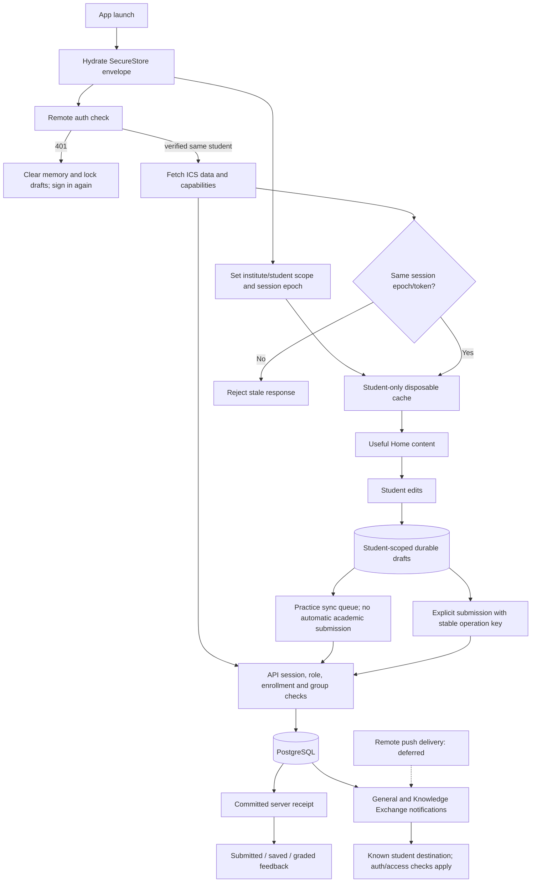

# ICS student mobile implementation

This is the execution record for the ICS student UX addendum. Existing CodeLab,
Knowledge Exchange and Practical Labs integration is preserved. No database reset,
destructive migration, deployment or production-data testing is part of this work.

## Agreed scope

- Native-first in stages; existing authenticated web workspaces are transitional.
- Phone learning and short practice; clearly identify work that needs a computer.
- Offline scope: documents, cards and drafts; never timed assessments offline.
- Preserve drafts on expiry; unlock only after the same student authenticates.
- Resume an actual item/route; do not invent video positions or completion values.
- Keep Inbox in the header, with five or fewer bottom destinations.

## Execution checklist

- [x] P0: partition caches by student/institute, reject stale responses, clear memory on identity changes.
- [x] P0: align flashcard, task and calendar contracts; remove fabricated rewards.
- [x] P0: durable assignment drafts and stable submission retry keys; protect hybrid edits.
- [x] P1: local-first launch, foreground session check, password recovery and persisted profile.
- [x] P1: Home Continue, academic deadlines and course list before shortcuts.
- [x] P1: correct form assessment routing and explicit online requirements.
- [x] P1: upload recovery, receipt feedback, accurate returned dates and notification routes/counts.
- [x] P1: readable type, contrast, accessible controls, keyboard/safe areas and reduced motion.
- [x] P1: avoid hidden background web features; bound lists and instrument useful-content readiness.
- [x] Verify mobile/web types, contract/lifecycle tests and native bundles.
- [x] Document physical-device gates and any provisioning still required.

## Explicitly deferred by the addendum

Full native Knowledge Exchange/CodeLab/Labs rewrites, a new grading engine, video
resume backend, universal native PDF annotations, spaced-repetition scheduling,
calendar sync, widgets, AI generation, study chat and a remotely provisioned push
delivery pipeline. In-app notifications must remain honest and functional.

## Verification limits

Automated fixtures use synthetic identities and mocked persistence boundaries.
Real Android/iOS performance, gestures, screen reader and interruption testing
require a physical device. Target budgets are targets, never measured claims.

## What changed

- Auth credentials now use a single SecureStore envelope. Legacy split records
  require a server check before exposing a restored identity. An unavailable
  server preserves current saved credentials; only 401 expires the session.
- Disposable caches use institute/student directories and session epochs.
  Previous unscoped caches are ignored. Queries and badge memory clear when the
  account changes; late responses cannot populate the next account's views.
- ICS has Home, Courses, Agenda, Community and Profile tabs. Inbox is in the
  Home header and Profile. Other departments keep their existing navigation.
- Home leads with Continue, actual academic deadlines and courses. Continue
  remembers a material/assignment route, with no invented video cursor or percent.
- Course Classwork opens first. Only the selected tab's dataset loads alongside
  its header. Rich lists use 20-row pages; courses, agenda and Inbox use FlatList.
- The agenda reuses the web calendar's enrollment/group/visibility rules.
- File work has one dedicated assignment screen. Attachment drafts use two
  alternating files so a partial write can recover the last complete version.
  Files are copied to the student's app directory before upload. Uploads show
  progress, cancellation and retry, and retain a local copy after interruption.
- Assignment retries retain an operation key and confirm server receipts.
  Explicit attachment replacement validates ownership inside the transaction;
  legacy callers retain their existing append behavior. Graded/returned work
  remains protected. Submitting never happens automatically when reconnecting.
- Flashcard ratings and completion match server schemas and show actual rewards.
  A durable review queue uses server receipts. No reward is fabricated offline.
- Native web workspaces retain student-scoped CodeLab buffers, question drafts
  and lab edits. Lab recovery detects revision conflicts before overwriting.
  Assessment recovery is restricted to the same live server attempt/deadline;
  offline assessment input is blocked and the server timer remains authoritative.
- Notification totals come from the whole server inbox, including ICS Knowledge
  Exchange updates. Read/delete operations remain scoped to the current student.
  Known links route into the corresponding student screen.
- Login has password recovery/support. Registration/join have keyboard and safe
  area handling. Profile edits persist and survive foreground auth refreshes.
- Reading sizes, shared control labels, contrast, font scaling, tab labels and
  reduced-motion behavior were improved. Hidden web timers/chatbots no longer
  mount inside native workspaces.
- Sentry is installed and initialized only for configured production monitoring,
  with 5% traces, no replay/screenshots/view hierarchy/log capture, and redacted
  student content. Local request and useful-content diagnostics are bounded.

## Release safety and compatibility

Deploy the web changes before distributing the new mobile build. Login and
`/api/auth/me` advertise `mobileCapabilities`. Native workspaces require
`hybridDrafts >= 1`; review replay requires `studentReceipts >= 1`. Missing
capabilities keep device work pending and offer web continuation. Older agenda
responses fail with an actionable update message instead of crashing. Missing
form metadata cannot send an assessment to the ordinary file-submission route.

`EXPO_PUBLIC_ICS_HOME_V2=false` rolls back the focused Home. Setting
`EXPO_PUBLIC_ICS_ASSESSMENTS_ENABLED=false` routes assessments to the web portal.
The privacy/contract/receipt fixes cannot be switched off. Remote push remains
disabled, asks for no permission on login, and its former stub returns 501 rather
than claiming a token was stored. No remote push delivery is claimed.

Sentry adds native code: produce a fresh development/production native build;
do not deliver this dependency change as an incompatible OTA update. Expo Go
keeps Sentry's native integration disabled. Configure the public DSN plus EAS
`SENTRY_ORG`, `SENTRY_PROJECT`, and secret `SENTRY_AUTH_TOKEN` before verifying
release symbolication. No monitoring account or credentials were provisioned.
The Expo-specific Metro integration preserves Expo 57's serializer/debug IDs.

The upload route allows a bounded four-minute body transfer and a five-minute
hosting duration; the client reserves time for server processing. Actual hosting
request-size/duration limits and malware-scanner availability still apply.
Lab evidence retains its file cap, ownership, revision and scanning checks.

No Prisma schema/migration changed. No database reset, deployment, production
write, administrative UI change, local code runner or Judge0 fallback was added.
CodeLab still requires the managed execution provider configured on the server.

## Data flow after the change

## Performance measurements and targets

The automated browser fixture observed three Home data requests after login
(courses, academic agenda and Inbox). Cached-session launch also verifies auth.
Course entry requested only its header and Classwork. These are fixture counts,
not a physical-device performance baseline. Local diagnostics count decoded
response text; use a network profiler for transferred/compressed bytes.

| Measurement | Target on a 4 GB / 60 Hz Android phone | Current device baseline |
| --- | --- | --- |
| Cold first display, p95 | <= 2.5 s | Unmeasured |
| Cached useful Home, p95 | <= 3 s | Unmeasured |
| Fresh Home, shaped network, p95 | <= 5 s | Unmeasured |
| Warm cached route, p95 | <= 300 ms | Unmeasured |
| Visible touch acknowledgement, p95 | <= 100 ms | Unmeasured |
| Critical Home / course requests | <= 4 / <= 2 | Fixture: 3 after login / 2 |
| Initial Home / refresh transfer | <= 200 KB / <= 50 KB, excluding media | Unmeasured |
| Slow UI frames | <= 5%; no >=250 ms stall | Unmeasured |
| Memory investigation threshold | >250 MiB native / >400 MiB with WebView | Unmeasured |
| Retained memory after 20 route cycles | <=20 MiB increase, no rising trend | Unmeasured |

Measure 20 cold and 20 warm launches on a release/profileable build, on Wi-Fi,
10 Mbps down/2 Mbps up/150 ms RTT, poor uplink and offline. Record build, device,
OS, thermal state and fixture version. Include app plus WebView renderer PSS,
JS/UI frame timelines, request counts and compressed transfer. Sentry captures
navigation/initial display when provisioned; custom useful-content marks and
`performanceSnapshot()` support local diagnostics. Debug/Expo Web timings do
not prove native release performance. No new image-heavy feed was introduced.

## Reproduction checks for the repaired failures

1. In staging, sign in as student A, load courses/grades and create an assignment
   draft. Return 401 for the foreground auth check, then sign in as B. A's cached
   records/draft must be absent. Signing in again as A restores A's draft.
2. Review cards, inspect `selfRating`, then finish a >=5-second session. The
   payload contains `cardsReviewed`, duration and a stable key. Lose the response
   and retry: the receipt prevents duplicate counts/rewards. No invented EXP.
3. Create a high-priority personal task, toggle it, then reload. Its title,
   description, due date and priority must survive the partial update. A foreign
   course link must be denied.
4. Upload an assignment file, cancel/drop connectivity, then reopen the screen.
   The local attachment remains pending with Retry upload. Lose a turn-in reply
   and retry: the same operation key confirms the same server submission.
5. Open a form-linked item from Classwork or Inbox. It must open the assessment,
   never a file-submission form. Interrupt/kill/reopen within its live deadline;
   recover unsent answers, preserve server-saved answers, and never extend time.

## Physical-device release gate

- Login, registration, OTP recovery, enrollment and account switching on staging.
- Home -> Continue/course -> material/assessment/assignment -> receipt -> feedback.
- 200% text, TalkBack/VoiceOver, dark/light appearance and reduced motion.
- One-hand taps, keyboard obstruction, Android Back and guarded iOS gestures.
- Call/background/force-stop during draft, review, upload, quiz and lab editing.
- Poor signal, reconnect, expired session and a real duplicate-response retry.
- Managed CodeLab execution, private file scanning and lab revision conflicts.
- Native crash symbolication after a fresh native build with Sentry configured.
- Check all target performance budgets above; run a small learner pilot before
  production rollout. Native video landscape/resume remains explicitly deferred.

These hardware/provisioning gates are open until someone actually runs them.
Automated test results are recorded below; they are not a deployment approval or
an engineering-harness release attestation.

## Verification record — 28 October 2026

| Check | Result |
| --- | --- |
| Mobile TypeScript | Pass |
| Web TypeScript | Pass |
| Harness TypeScript | Pass |
| Mobile lifecycle, contracts, storage, uploads and security fixtures | 27 pass |
| Current grade-period calculator regressions | 6 pass |
| Practical Labs schema, presets, resources and transport | 18 pass |
| Academic submission contracts and HTTP mutation guards | 2 pass |
| Engineering-harness unit tests | 69 pass |
| Android / iOS Hermes and web production exports | Pass |
| Expo Web student walkthrough at 320 / 390 / 768 px | Pass |
| Whitespace/error checks (`git diff --check`) | Pass |

The 122 passing tests above are selected regression/unit checks, not the entire
repository suite or a real-database end-to-end run. Database boundaries are mocked
in mobile fixtures and no live credentials/database were used. The harness tests
required ordinary OS temporary directories with permission for disposable Git and
protected signing-key fixtures; repository-local temporary keys are intentionally
rejected. No controller release approval or independent security attestation was
manufactured from these passing tests.

One existing test outside these passing checks remains broken:
`tests/web-quality/academic.test.cjs` extracts a removed `computeFinalGrade`
function from the gradebook client and throws `ReferenceError`. The function is
absent in both the baseline and current client. The current period-calculation
tests pass; the obsolete source-extraction test and gradebook were not changed.

The browser walkthrough uses only synthetic API replies and blocks production and
third-party traffic. It covers sign-in, five visible tabs, Agenda, Community,
profile edit/cancel, light/dark Home, 48 px tab targets, bounded course pages and correct assessment
routing. No browser page errors were recorded. Screenshots are in
`tmp/mobile-ics-review/`; the runnable fixture is
`tests/mobile/preview-smoke.cjs`. This is Expo Web layout evidence; WebView,
TalkBack/VoiceOver, device performance and native interruptions remain unverified.

The final account-switch checks also cover switching during queued completion
sync, during a file picker and after a durable attachment save. Old callbacks
cannot start uploads or write submission state under the next student's scope.

### Rollout prerequisites

1. Deploy these web/API changes first; confirm the advertised capabilities in
   staging. Keep existing server session, enrollment, file-scanner and managed
   execution safeguards enabled.
2. Produce a fresh native build for the added Sentry native dependency. Do not
   send this as an OTA update to a binary that lacks that dependency.
3. Configure Sentry organization/project, the public DSN and protected build-time
   source-map credentials when ready. Missing monitoring credentials leave
   reporting disabled; native symbolication has not been verified.
4. Run the physical-device gate above and a small ICS student pilot before
   production distribution. `adb devices` found no attached device in this run.

No deployment, native store distribution, migration or production-data mutation
was performed. All explicitly deferred items remain deferred.
